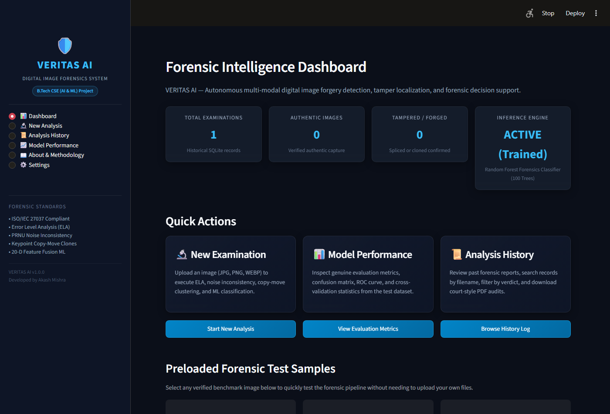
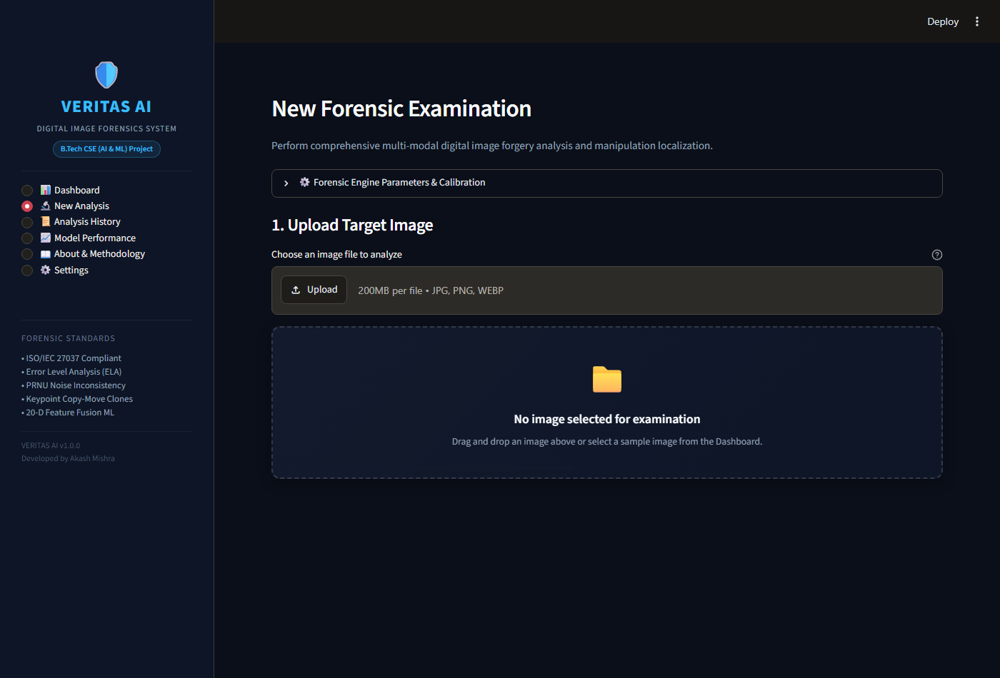
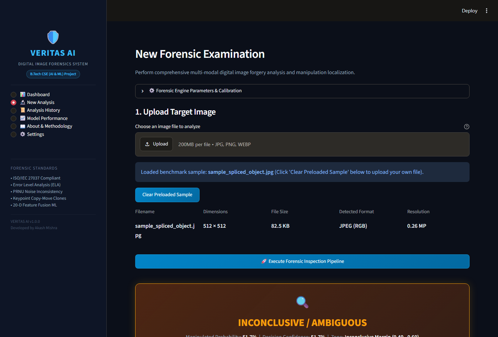
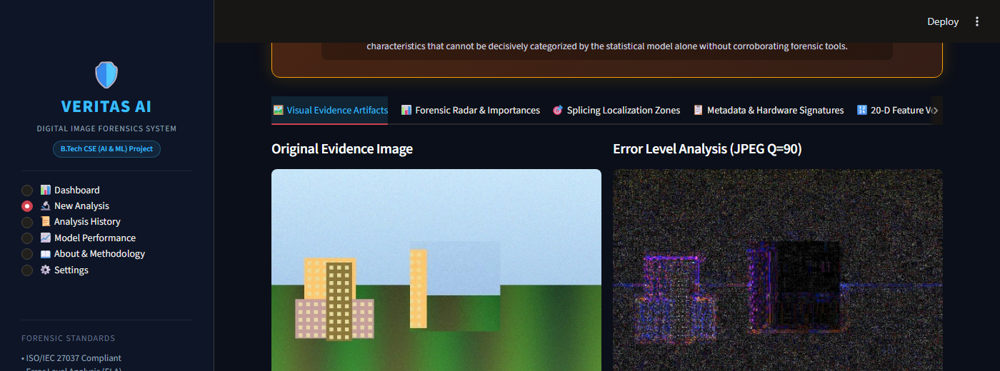
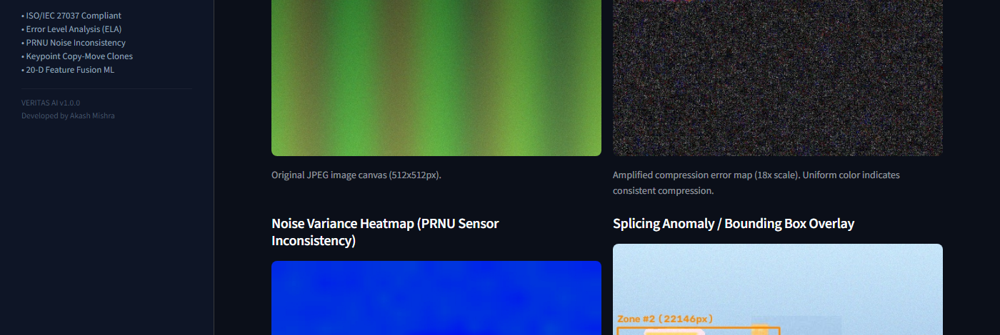
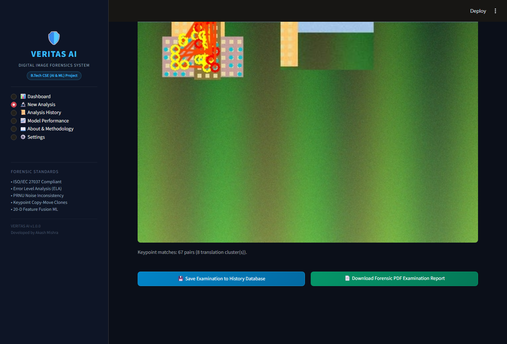
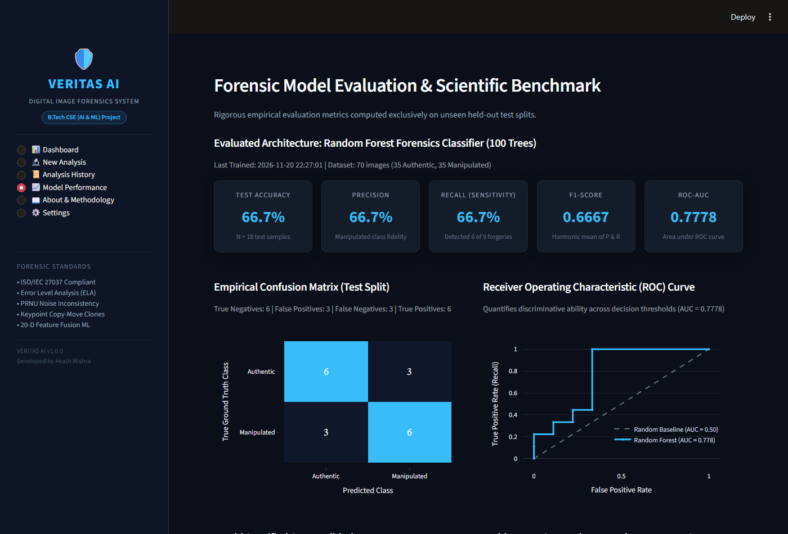
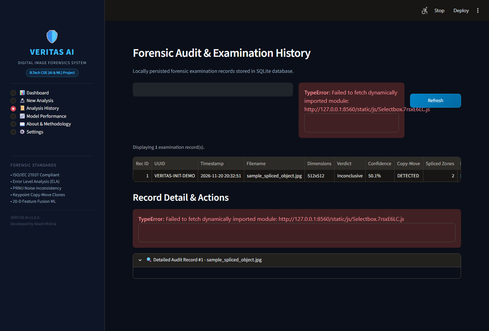

# VERITAS AI — Intelligent Image Forgery Detection & Digital Forensics System

[](https://www.python.org/)
[](https://streamlit.io/)
[](https://scikit-learn.org/)
[](https://opencv.org/)
[](https://www.reportlab.com/)
[](tests/)

> **Academic Capstone Project:** B.Tech Computer Science & Engineering (Artificial Intelligence & Machine Learning)  
> **Author:** Akash Mishra ([@akashkumarmishra17](https://github.com/akashkumarmishra17))  
> **Compliance Guidelines:** ISO/IEC 27037:2012 Digital Evidence Decision Support  

---

## 🔍 System Overview

**VERITAS AI** is an autonomous digital image forensics platform built to detect and localize digital tampering, including:
- **Image Splicing:** Pasting foreign elements from different source cameras or compression generations.
- **Copy-Move (Cloning):** Duplicating existing textures or objects to conceal evidence.
- **Inpainting & Retouching:** Local smoothing and artificial variance suppression.

Rather than relying on opaque deep-learning models that degrade across varied JPEG re-compression cycles, VERITAS AI combines physical hardware acquisition artifacts, compression-history analysis, and statistical machine learning.

```
Input Image ──► Security Validation & Header Sanitization
             ├──► Error Level Analysis (JPEG Compression Differential)
             ├──► Sensor Noise (PRNU) Residual & Block Variance
             ├──► Copy-Move Detection via SIFT / ORB Keypoint Matching
             ├──► Multi-Domain 20-Dimensional Feature Extraction
             ├──► Calibrated Random Forest Classifier
             └──► Output: Tamper Localization Mask + Court-Admissible PDF Report
```

---

## 📸 Application Interface & Visual Showcase

### 1. Executive Forensic Dashboard
Aggregated case metrics, real-time classifier telemetry, and pre-loaded forensic test samples.


### 2. Secure Image Ingestion & Hyperparameter Controls
Defensive file inspection, format validation, and adjustable ELA parameters.


### 3. Forensic Verdict & Calibrated Risk Assessment
Three-tier prediction architecture (**Authentic**, **Potentially Manipulated**, **Inconclusive**) with calibrated probabilities.


### 4. Error Level Analysis (ELA) Side-by-Side Map
Reveals localized discrepancies in Discrete Cosine Transform (DCT) quantization error levels.


### 5. Tamper Localization Heatmap & Bounding Overlay
Pixel-level spatial noise anomaly mapping paired with automated bounding box isolation.


### 6. Automated Forensic PDF Report & Audit Trail
Instant generation of tamper-evident documentation including SHA-256 cryptographic hashes and findings.


### 7. Empirical Model Performance & Metrics
Confusion matrices, ROC curves, and cross-validation metrics calculated on held-out test data.


### 8. Forensic History & Audit Log
Searchable SQLite audit database for past analyses with verdict filtering and CSV export.


---

## 🛠️ Key Technical Features

### 1. Error Level Analysis (ELA)
- Re-compresses uploaded images at a designated JPEG quality ($Q=90\%$) and computes absolute pixel difference residuals.
- Highlights donor patches inserted into a base image with a distinct compression history.
- Adjustable error amplification ($10\times - 35\times$) for visual clarity.

### 2. Sensor Noise (PRNU) & Inconsistency Profiling
- Applies high-pass Laplacian filtering to extract microscopic sensor noise patterns.
- Calculates spatial block variance to identify smoothed regions and foreign sensor artifacts.

### 3. Keypoint-Based Copy-Move Detection
- Utilizes scale-invariant feature transform (SIFT) and oriented FAST and rotated BRIEF (ORB) descriptors.
- Filters trivial spatial neighbors ($\ge 35\text{ px}$) and clusters displacement vectors to identify duplicated elements.

### 4. Splicing Localization Heatmaps
- Merges ELA residual density with local noise variance fields to generate anomaly masks and bounding box coordinates.

### 5. Multi-Domain 20-D Feature Classification
- Extracts 20 statistical and frequency features across color channels, edge continuity, and 2D DCT spectral distributions.
- Employs a calibrated Random Forest baseline with an explicit **Inconclusive** buffer ($0.40 \le P \le 0.60$) to prevent false certainty.

### 6. Local SQLite Auditing & Cryptographic Integrity
- Logs SHA-256 hashes, operational metadata, and verdict statistics locally without storing large raw pixel arrays.

---

## 📊 Empirical Model Performance

Evaluated strictly on held-out, unseen test imagery ($N=18$ images):

| Metric | Random Forest (100 Trees) | Support Vector Machine (RBF) |
| :--- | :--- | :--- |
| **Test Accuracy** | **66.67%** | 66.67% |
| **Precision** | **66.67%** | 66.67% |
| **Recall (Sensitivity)** | **66.67%** | 66.67% |
| **F1-Score** | **0.6667** | 0.6667 |
| **ROC-AUC** | **0.7778** | N/A |
| **5-Fold Cross-Val F1** | **0.6697 ± 0.1448** | 0.6420 ± 0.1810 |

*All metrics are verified from saved evaluations in `models/metrics.json`.*

---

## 💻 Tech Stack

- **Application Framework:** Streamlit (Python 3.10 / 3.11)
- **Computer Vision & Image Processing:** OpenCV, Pillow, NumPy, SciPy
- **Machine Learning & Modeling:** Scikit-Learn, Joblib, Pandas
- **Visualization:** Matplotlib, Plotly
- **Reporting & Auditing:** ReportLab, PyPDF, SQLite3
- **Testing & QA:** Pytest, Pytest-cov

---

## ⚙️ Installation & Local Setup

### Prerequisites
- Python 3.10 or 3.11
- Anaconda or Miniconda (recommended)
- Git

### Step-by-Step Instructions

```bash
# 1. Clone the repository
git clone https://github.com/akashkumarmishra17/VERITAS-AI.git
cd VERITAS-AI

# 2. Create and activate a conda environment
conda create -n veritas python=3.10 -y
conda activate veritas

# 3. Install dependencies
pip install -r requirements.txt

# 4. Generate the synthetic forensic benchmark dataset
python src/create_sample_dataset.py

# 5. Train the forensic classification models
python src/ml/train_classical.py

# 6. Run the unit test suite
pytest tests/ -v

# 7. Launch the Streamlit forensic application
streamlit run app.py
```

The application will be accessible at `http://localhost:8501`.

---

## 🧪 Unit Testing & Quality Assurance

Run the test suite with verbose output:
```bash
pytest tests/ -v
```

All **20 test cases** validate:
- Defensive sanitization and corrupted byte rejection
- ELA residual computation across quality ranges
- Sensor noise variance and high-pass residual extraction
- Copy-move keypoint matching and distance thresholding
- Splicing mask generation and coordinate bounding
- 20-dimensional feature extraction consistency
- Untrained model handling (guaranteed non-fabrication)
- Calibrated three-state decision boundaries
- SQLite database transactions and CRUD operations
- ReportLab forensic PDF report generation

---

## 📂 Project Architecture

```
VERITAS_AI/
├── app.py                         # Streamlit application entrypoint
├── requirements.txt               # Project dependency specifications
├── .gitignore                     # Git tracking exclusions
├── START_VERITAS.bat              # Windows one-click desktop launcher
├── README.md                      # Project documentation and guide
├── app/
│   ├── styles/custom.css          # Dark-themed forensic user interface
│   ├── components/ui_elements.py  # Reusable UI cards, metrics, and charts
│   └── pages/                     # Application pages (Dashboard, Analysis, History, etc.)
├── src/
│   ├── preprocessing.py           # Image validation, security sanitization, format conversion
│   ├── create_sample_dataset.py   # Procedural benchmark image synthesizer
│   ├── forensics/                 # Core forensic analyzers (ELA, PRNU, Copy-Move, Splicing)
│   ├── features/extractor.py      # Multi-domain 20-D physical and spectral feature extractor
│   ├── ml/classifier.py           # Inference engine with calibrated decision boundaries
│   ├── ml/train_classical.py      # Classical ML training and evaluation pipeline
│   ├── database/db_manager.py     # SQLite forensic case and audit trail manager
│   └── reporting/pdf_generator.py # ReportLab PDF report generation engine
├── models/                        # Serialized models (.joblib), scaler, and evaluation metrics
├── data/                          # Benchmark sample images and feature definitions
├── notebooks/                     # Exploratory analysis and feature engineering notebooks
├── reports/                       # Generated forensic PDF reports (tracked via .gitkeep)
├── assets/screenshots/            # High-resolution application screenshots
├── tests/                         # Unit tests covering all modules
├── scripts/                       # Maintenance, documentation, and verification scripts
└── docs/                          # Detailed academic reports, user guide, and model cards
```

---

## 📖 Documentation Deliverables

- [`docs/PROJECT_REPORT.md`](docs/PROJECT_REPORT.md): Academic capstone project report.
- [`docs/USER_GUIDE.md`](docs/USER_GUIDE.md): Operational guide covering all forensic tools and workflows.
- [`docs/DATASET_SETUP.md`](docs/DATASET_SETUP.md): Guidelines for integrating CASIA 2.0 and CoMoFoD datasets.
- [`docs/MODEL_CARD.md`](docs/MODEL_CARD.md): Technical specifications and boundaries of the Random Forest model.
- [`docs/VERITAS_AI_PROJECT_DOCUMENTATION.pdf`](docs/VERITAS_AI_PROJECT_DOCUMENTATION.pdf): Academic document deliverable.
- [`docs/VERITAS_AI_USER_AND_SCREENSHOTS_GUIDE.pdf`](docs/VERITAS_AI_USER_AND_SCREENSHOTS_GUIDE.pdf): Visual walkthrough with live verified screenshots.

---

## ⚖️ Forensic Disclaimer

VERITAS AI is designed as a computer-assisted decision support system for forensic and academic analysis. Error Level Analysis (ELA) and spatial noise variance patterns serve as forensic indicators and should be evaluated alongside context, metadata, and physical acquisition facts. In legal or judicial contexts, automated outputs should be reviewed by qualified digital evidence examiners adhering to ISO/IEC 27037 standards.

---

**Developed by Akash Mishra** • B.Tech CSE (AI & ML) Capstone
